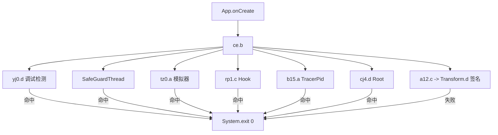

# 体适能 App 2.0.25 逆向分析

> 基于 SecShell 脱壳、FuckTSN 2.0.25 适配与 Python 协议工具对比的完整分析报告。

## 基本信息

| 项目 | 详情 |
|------|------|
| 包名 | `com.bxkj.student` |
| 版本 | **2.0.25**（versionCode 20250） |
| 开发商 | 北京体适能体育科技有限公司 |
| 加固方案 | **SecShell**（2.0.22 为 360 加固） |
| 真实代码 | 8 个 DEX，约 52,000 个类 |
| 核心 Native | `libtsnsecret.so`、`libSecShell.so`、`libemulator_check.so`、`libproperty_get.so` |
| 地图 SDK | 高德地图（AMap） |
| 安全 / 广告 SDK | 快手安全 SDK、腾讯广点通、穿山甲、百度、BeiZi 等 |
| 测试环境 | Android 10 + Magisk + LSPosed 1.9.2 |
| 分析日期 | 2026-10-21 |

> 本仓库仅包含分析文本，不包含 APK、账号凭据、Token、个人数据或可直接用于作弊的成品工具。

---

## 结论摘要

1. **2.0.25 换成了 SecShell 加固**，不再是 2.0.22 的 360 加固；真实业务代码被加密放在 DEX 尾部，运行时通过 `InMemoryDexClassLoader` 加载。
2. 启动安全总控是默认包类 **`ce`（SafeGuard）**，依次检查调试、模拟器、Hook、TracerPid、Root、原生签名，任一命中就 `System.exit(0)`。
3. **很多“启动不了”并不是 Root 检测，而是 `/data/local/tmp/frida-server` 文件检测**（`rp1.a()`）。删除该文件后，2.0.25 可以在已 Root 设备上正常进入首页。
4. LSPosed 注入体适能需要把应用移出 **Magisk DenyList**；否则 LSPosed 日志会提示 `may not take effect`。
5. 原 FuckTSN v2.0.18 只支持 2.0.15–2.0.18，安全类名在 2.0.25 已被 R8 重命名。适配版已完成并在真机验证，PR 见 [pansoul1/FuckTSN#2](https://github.com/pansoul1/FuckTSN/pull/2)。
6. **Python 协议工具（Tishineng-Running）只算“协议底座兼容”**：加密常量、环境字段、旧接口仍在，但 2.0.25 的登录已改为 `rsa-public-key` + `app/login` + RSA 加密密码，旧 OAuth 登录会返回“验证码不能为空”，因此它不是 2.0.25 开箱即用版本。

---

## 一、加固与脱壳

### 1.1 SecShell

2.0.25 的 APK 结构：

- 外层 `classes.dex` 只有 **541 个壳类**（`com.SecShell.SecShell.*`）。
- 真实 DEX 被加密附加在 DEX 尾部约 **74.6MB** 区域。
- `libSecShell.so` 负责解密，并通过 `InMemoryDexClassLoader` 加载。
- 真实 Application 为 `com.bxkj.student.App`，由壳反射实例化。

### 1.2 脱壳结果

| 文件 | 大小 | 类数 |
|---|---:|---:|
| classes.dex | 5,524,784 | 4,175 |
| classes2.dex | 10,855,428 | 8,477 |
| classes3.dex | 11,658,184 | 9,340 |
| classes4.dex | 11,096,552 | 8,969 |
| classes5.dex | 11,885,944 | 9,194 |
| classes6.dex | 11,979,724 | 8,655 |
| classes7.dex | 11,602,608 | 9,319 |
| classes8.dex | 272,660 | 222 |

合计约 **52,351 个类**。

### 1.3 脱壳方法

1. 启动 App，轮询 `/proc/<pid>/maps`；
2. 出现 `[anon:dalvik-DEX data]` 时立即 `SIGSTOP`；
3. 从 `/proc/<pid>/mem` 按页转储；
4. 按 `dex\n035` 魔数和 `file_size` 切分；
5. 用 JADX 反编译分析。

---

## 二、安全检测机制

### 2.1 启动总控 `ce`

`com.bxkj.student.App.onCreate()` 调用 `ce.a.b()`，顺序如下：



### 2.2 检测类明细

| 2.0.25 类 | 旧版类 | 功能 | 关键方法 |
|---|---|---|---|
| `ce` | — | 启动总控 | `b()` / `a()` |
| `yj0` | `safe.c` | Debug 检测 | `d()` |
| `tz0` | `safe.d` | 模拟器检测 | `a()` |
| `rp1` | `safe.f` | Hook 检测 | `a()` / `b()` / `c()` |
| `b15` | `safe.h` | TracerPid | `a()` |
| `cj4` | `safe.g` | Root 检测 | `d()` |
| `a12` | — | 签名校验包装 | `c(Context)` |
| `Transform` | `Transform` | 原生签名 | `d(Context)` |
| `s11` | `EnvironmentCheck` | 环境自检记录 | `a()` |

### 2.3 关键检测内容

- **`yj0`**：`Debug.isDebuggerConnected()`、`waitingForDebugger()`、`/proc/net/tcp` 的 `0100007F:0016`、`FLAG_DEBUGGABLE`。
- **`b15`**：读取 `/proc/<pid>/status` 的 `TracerPid`。
- **`tz0`**：`libemulator_check.so` + Build 属性 + qemu 文件 + 多开检测。
- **`rp1`**：
  - `a()`：`/data/local/tmp/frida-server` 是否存在；
  - `b()`：`Class.forName("de.robv.android.xposed.XposedBridge")`；
  - `c()`：以上任一。
- **`cj4`**：
  - `Build.TAGS` 含 `test-keys`；
  - 10 个 su 路径；
  - `Runtime.exec("/system/xbin/which", "su")`。
- **`a12`**：`Transform.d(Context)`，native 签名/正版校验。

### 2.4 跑步入口二次校验

`k55.a0()` 在开始跑步前再次检查，错误码：

| 条件 | 错误码 |
|---|---|
| 签名失败 | 1001 |
| Root | 1002 |
| 模拟器 | 1003 |
| Hook | 1004 |
| 调试/TracerPid | 1005 |
| 断点 | 1006 |

### 2.5 Native 安全

- `libemulator_check.so`：导出 `EmulatorDetectUtil.detect`，通过 RWX mmap + 自修改 ARM64 shellcode + 信号处理判断模拟器。
- `libproperty_get.so`：调用 `java.lang.System.getProperty`。
- `libtsnsecret.so`：约 12MB，JNI 动态注册，负责签名、AES/RSA、`uniqueCode`、`Transform.d()`。
- `libSecShell.so`：SecShell 解密/加载。

---

## 三、签名与加密

核心类：`com.google.android.datatransport.Transform`，JNI 库 `libtsnsecret.so`。

| 方法 | 功能 |
|---|---|
| `v(ctx, token, timestamp)` | 生成请求签名 |
| `u(ctx, appId, token, timestamp)` | 带 appId 的签名 |
| `s(ctx, token, timestamp, data)` | 加密数据，返回 `[key, param]` |
| `t(ctx, encryptedData, key)` | 解密 |
| `a(ctx)` | 获取签名 MD5 |
| `x(ctx)` | 获取 `uniqueCode` |
| `r(ctx, str, map)` | 带参数签名 |
| `w(ctx, str, map)` | 带参数签名 |

2.0.25 中仍然存在的关键常量：

```text
appSecret     = e8167ef026cbc5e456ab837d9d6d9254
public appId  = c9292ee89d2f49492f983f5931af0d09
password key  = thanks,pig4cloud（旧登录流程）
signatureMD5  = 7F:C0:22:E6:7C:7D:2A:CC:C3:C8:77:0A:46:13:8D:C3
```

- 项目中的 RSA 公钥前缀在 `libtsnsecret.so` 中可以找到。
- 用 2.0.25 证书计算的 `app_sign_hash` 为 `d2tnIyqximO/L8Y4MzfRELa1hSAtSRxzmvXlcOCzRyk=`，与开源 SDK 的 `KNOWN_APP_SIGN_HASH` 完全一致。
- 说明 **2.0.25 的签名/加密底座没有换**，但登录方式变了（见第七节）。

---

## 四、启动失败根因与运行时验证

### 4.1 真正元凶：frida-server 文件

`rp1.a()` 只检查：

```java
new File("/data/local/tmp/frida-server").exists()
```

只要这个文件存在，`rp1.c()` 为真，`ce.b()` 就会退出。

实测：

```text
删除 /data/local/tmp/frida-server
→ App 稳定运行到 com.bxkj.student.v2.ui.MainActivity
```

### 4.2 为什么 LSPosed 没生效

- `com.bxkj.student` 在 Magisk DenyList 中；
- LSPosed 日志：`com.bxkj.student is on denylist. It may not take effect.`；
- 需要把体适能移出 DenyList，LSPosed 才能注入。

### 4.3 为什么“注入成功反而退出”

`rp1.b()` 会检查 `de.robv.android.xposed.XposedBridge`。  
只要 LSPosed 注入，这个类就存在，`rp1.c()` 返回 true，`ce` 退出。  
因此 Hook 模块必须先 Hook `rp1` / `ce`，否则“注入即触发检测”。

---

## 五、FuckTSN 2.0.25 适配

原 FuckTSN v2.0.18 只支持 2.0.15–2.0.18，旧 `safe.*` 类在 2.0.25 已失效。适配映射：

| 旧类 | 功能 | 2.0.25 新类 |
|---|---|---|
| `safe.c` | Debug | `yj0` |
| `safe.d` | 模拟器 | `tz0` |
| `safe.f` | Hook | `rp1` |
| `safe.g` | Root | `cj4` |
| `safe.h` | TracerPid | `b15` |
| — | 启动总控 | `ce` |
| — | 签名包装 | `a12` |
| — | 原生签名 | `Transform.d` |

适配策略：

1. `ClassLoader.loadClass` 拦截 + 精确类名匹配；
2. 在 `App.onCreate()` 前主动加载并 Hook 新安全类，兼容 InMemoryDex；
3. Hook `ce.b()/ce.a()` 跳过启动检测；
4. Hook `a12.c` 与 `Transform.d` 绕过签名；
5. 退出兜底：`System.exit` / `Runtime.exit/halt` / `Process.killProcess`；
6. 线程安全 Hook 注册表。

详细类名映射与 Hook 说明见 [docs/2.0.25-class-mapping.md](docs/2.0.25-class-mapping.md)。

实测日志：

```text
FuckTSN: [2.0.25] App.onCreate 前主动加载安全类
FuckTSN:  SafeGuard(ce.b) Hook成功: ce
FuckTSN:  Hook检测类(rp1.c) Hook成功: rp1
FuckTSN:  签名包装类(a12.c) Hook成功: a12
FuckTSN:  Transform.d 原生签名校验 Hook成功
FuckTSN: [2.0.25] SafeGuard.ce.b() -> 跳过全部启动检测
```

PR：[pansoul1/FuckTSN#2](https://github.com/pansoul1/FuckTSN/pull/2)（5 个文件，+418/-12）。

---

## 六、跑步/运动核心逻辑

以 Tishineng-Running 项目为例，一次跑步的流程：

1. **授权**：公版 OAuth / 私版学校登录；
2. **获取设置**：`getExerciseSetting` → 围栏、必经点、距离、时间、步数、人脸要求；
3. **生成轨迹**：`resample_track` 沿历史路径推进，1 秒采样，速度抖动 8%，pingpong 折返；
4. **步数分桶**：步幅 = `0.6 + 0.14 × 速度`，60 秒一个桶，最大余数法保证总步数；
5. **轨迹校验**：时间戳递增、速度×时间与距离一致、累计距离单调、步数桶合计、首末点匹配；
6. **等待**：按结束时间真实等待；
7. **人脸**：开始/中途/结束上传账号已有照片（随机像素修改）；
8. **提交**：`addExerciseRecord`，带 `d/f/m/h/isValid/remarkId/environment`；
9. **复核**：查询 `sportStatus`/`remark`，再查有效次数与统计。

环境伪造字段：

```json
{
  "deviceId": "...",
  "oppo": "{\"auth\":\"success\",\"root\":{\"result\":\"false\"},...,\"checksum\":\"...\"}",
  "safe": "{\"sign\":\"true\",\"root\":\"false\",\"emulator\":\"false\",\"hook\":\"false\",\"debug\":\"false\",\"breakpoint\":\"false\",\"supported_abis\":[...]}"
}
```

服务端仍可能通过设备指纹、轨迹自然度、人脸、环境上报做二次判定；客户端绕过不等于服务端不判定。

---

## 七、API 通信与 2.0.25 兼容性

### 7.1 老接口仍在

Tishineng-Running 的 43 条旧路由（`auth/oauth/token`、`exercise/...`、`upms/...`）都能在 `libtsnsecret.so` 中找到；基础学校接口 `POST m.boxkj.com/app/province/findAllProvince` 用 20230/20250 版本号都能返回正常。

### 7.2 2.0.25 的新登录

2.0.25 的 v2 登录链路：

```text
LoginActivity → LoginViewModel → LoginRepository
  → GET rsa-public-key
  → RSA 加密密码
  → POST app/login
     username=...
     password="RSA:" + Base64(RSA(password))
     grant_type=password
     type=app
     appType=stuApp
```

而 Tishineng-Running 仍使用：

```text
AES-ECB(password, "thanks,pig4cloud")
  → POST auth/oauth/token
  → Basic base64(schoolCode + ":pig")
```

### 7.3 实测差异

| 请求 | 结果 |
|---|---|
| `POST https://a.tsnkj.com/auth/oauth/token`（假账号） | **428 验证码不能为空** |
| `POST https://m.boxkj.com/app/login`（假账号） | 200 `{"returnCode":601,"returnMsg":"认证失败"}` |
| `POST https://m.boxkj.com/app/province/findAllProvince` | 正常返回省份列表 |
| `/rsa-public-key`、`/app/login` on `a.tsnkj.com` | 404 |

### 7.4 结论

Tishineng-Running **不是 2.0.25 开箱即用版本**：

- ✅ 加密常量、RSA 公钥、`appSignHash`、环境字段、旧路由兼容；
- ❌ 版本号仍是 `2.0.23 / 20230`；
- ❌ 登录仍是旧 OAuth + AES，2.0.25 已改为 RSA + `/app/login`；
- ❌ 旧 OAuth 现在要求验证码（428），项目没有处理；
- ❌ 新版 `/app/exerciseSettingV2`、`/app/addExerciseRecord` 等接口未实现。

详细对比见 [docs/protocol-compatibility.md](docs/protocol-compatibility.md)。

---

## 八、功能全貌

### 8.1 主界面

首页、分类、动态、消息、我的；  
快捷入口：在线选课、场馆预约、预约体测、AI 运动处方、在线学习、预约记录、阳光跑步、体测成绩、跑步记录、申请免测、查看选课、更多。

### 8.2 业务模块

- **教学**：考试、评教、考勤（蓝牙/BLE/二维码）、请假、作业、在线学习、选课、成绩、健康状态、免测、证书、预约。
- **体测**：预约、成绩、排名、计算器、免测申请、申诉、准考证、视力录入、监测记录。
- **跑步**：晨跑/阳光跑/自由跑、开始跑、锁屏、步数/定位、人脸验证、Keep 同步、课外签到、申诉、统计、排名。
- **生活**：商城、二手、失物招领、资讯、订单/支付/物流/地址。
- **竞赛**：报名、付费项目、成绩、检录、新闻、电子参赛证。
- **场馆/器材**：场地申请、场馆列表、器材申请、历史记录。
- **其他**：校内圈、Netty 聊天、消息、反馈、二维码、签到、账号绑定、AI/AR 运动。

### 8.3 第三方 SDK

高德地图/定位、极光推送、友盟、Bugly、腾讯广点通、穿山甲、快手、百度广告/人脸、华为 HMS/AGConnect、EasyAR、MLKit、ijkplayer、SQLCipher、MMKV、Netty、微信/QQ 登录支付、一键登录（含无障碍服务/设备管理员组件）。

### 8.4 权限

55 项，包括后台定位、精确定位、相机、录音、读取手机状态、拨打电话、悬浮窗、安装未知应用、忽略电池优化、前台服务、开机自启、蓝牙、活动识别等。

---

## 九、生态项目对比

| 项目 | 结论 |
|---|---|
| [FuckTSN](https://github.com/pansoul1/FuckTSN) | Xposed 模块，原支持 2.0.15–2.0.18；本报告已完成 2.0.25 适配并提 PR |
| [tishineng-analysis](https://github.com/jry21223/tishineng-analysis) | 2.0.22 分析：360 加固、`safe.*`、`Transform`/`x.b` |
| Tishineng-Running / TiShiNengRunning-main | 完整 Python 协议工具，适合协议研究；登录未适配 2.0.25 |
| TiShiNengSdk | 清洗过的 Python SDK，仅结构参考 |
| TiShiNengHacker | 空壳 Compose 工程，无实用逻辑 |
| fitness | 微信小程序 + Java 后端，与本 App 无关 |
| Tishineng-Demo / V1 | 本地 Fork：必经点注入、GPS 噪声、路径合成、path_only 账号 |

---

## 十、复现与产物

本仓库不包含二进制 APK。复现所需步骤：

```bash
# 1. 获取 2.0.25 APK（自行合法获取）
# 2. 脱壳：启动后冻结进程，转储 /proc/<pid>/mem 的 dalvik-DEX data
# 3. 切分 DEX：按 dex\n035 + file_size
# 4. 反编译：JADX
```

FuckTSN 适配版构建：

```bash
cd app
./gradlew :app:assembleDebug
```

产物类别：

- 8 个真实 DEX；
- JADX 反编译源码；
- Manifest、字符串、日志、截图（本地保留，不入库）；
- FuckTSN 2.0.25 源码补丁与适配文档。

---

## 十一、风险与限制

1. **客户端绕过不等于服务端不判定**：设备指纹、轨迹、人脸、环境上报仍可能触发风控。
2. **R8 类名会变**：2.0.25 的 `ce/cj4/...` 可能在后续版本再次重命名。
3. **LSPosed 与 DenyList 冲突**：注入需要移出 DenyList；移出后 Root 对其它 App 可见。
4. **debug 签名**：自行构建的模块更新需同一 keystore 或卸载重装。
5. **登录协议已变化**：旧 OAuth + AES 方案在 2.0.25 上大概率不可用。
6. **仅供学习交流与安全研究**，不要用于代刷、作弊或侵犯他人账号。

---

## 免责声明

本项目仅供学习交流和安全研究使用。请遵守所在学校、平台及当地法律法规。使用本项目产生的任何后果由使用者自行承担。

## 相关链接

- [FuckTSN](https://github.com/pansoul1/FuckTSN)
- [FuckTSN 2.0.25 PR #2](https://github.com/pansoul1/FuckTSN/pull/2)
- [tishineng-analysis（2.0.22 参考）](https://github.com/jry21223/tishineng-analysis)
- [ZXWITNESS/fitness（逆向资源）](https://github.com/ZXWITNESS/fitness)
